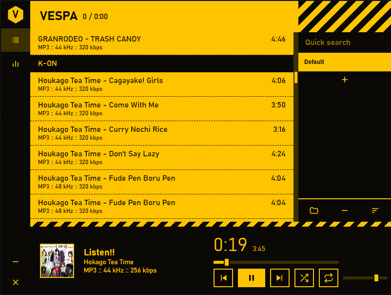

# Vespa

[](https://tauri.app)
[](https://www.typescriptlang.org)
[](https://www.rust-lang.org)
[](https://vitejs.dev)
[](LICENSE)
[](#requirements)
[](#roadmap)

A minimal, frameless desktop music player built with **Tauri v2** and **TypeScript**.
Yellow-on-black. Keyboard-friendly. Designed to feel like a native app — not a webpage in a window.



---

## Table of Contents

- [Features](#features)
- [Requirements](#requirements)
- [Installation](#installation)
- [Development](#development)
- [Building](#building)
  - [Build Outputs](#build-outputs)
  - [Running the Built App](#running-the-built-app)
  - [Code Signing](#code-signing)
- [Project Layout](#project-layout)
- [Architecture](#architecture)
- [Configuration](#configuration)
  - [Asset Protocol Scope](#asset-protocol-scope)
  - [Window Permissions](#window-permissions)
  - [Icons](#icons)
- [Troubleshooting](#troubleshooting)
- [Known Limitations](#known-limitations)
- [Roadmap](#roadmap)
- [Contributing](#contributing)
- [License](#license)
- [Credits](#credits)

---

## Features

| | |
|---|---|
| **Folder scanning** | Recursively finds `mp3`, `flac`, `ogg`, `wav`, `m4a`, `opus` |
| **Multiple playlists** | Create, rename, delete, and switch on the fly |
| **Persistence** | Playlists saved to `playlists.json` in the app data directory |
| **Metadata** | Title, artist, duration, bitrate, sample rate, and embedded album art via [lofty](https://github.com/Serial-ATA/lofty-rs) |
| **Search and sort** | Live filter of the active playlist; sort by path, title, or duration |
| **Playback** | Play/pause, prev/next, shuffle, repeat (off/all/one), seek, volume |
| **Mini mode** | Shrinks to a small always-on-top bar; drag anywhere to move |
| **Frameless window** | Square corners, custom chrome, drag via the logo |
| **Native feel** | Copy/paste, context menu, and text selection disabled |

---

## Requirements

| Tool | Version | Notes |
|---|---|---|
| **Node.js** | 18+ | LTS recommended |
| **Rust** | Stable | Install via [rustup](https://rustup.rs) |
| **Platform prerequisites** | — | [tauri.app/start/prerequisites](https://tauri.app/start/prerequisites/) |

### Windows

- **Microsoft C++ Build Tools** — install via the Visual Studio Build Tools installer with the **"Desktop development with C++"** workload
- **WebView2** — preinstalled on Windows 11; on Windows 10 it may need the [Evergreen Runtime](https://developer.microsoft.com/microsoft-edge/webview2/)

### macOS

- **Xcode Command Line Tools**: `xcode-select --install`

### Linux

- **WebKitGTK**, **libappindicator**, and typical build dependencies — see the Tauri prerequisites page for your distribution

---

## Installation

If you already have a built installer:

1. **Windows** — run `vespa_0.1.0_x64_en-US.msi` or `vespa_0.1.0_x64-setup.exe`
2. **macOS** — open `Vespa.app` from the `.dmg`
3. **Linux** — install the `.deb` (`sudo dpkg -i vespa_0.1.0_amd64.deb`) or run the `.AppImage`

The installer handles everything else: Start Menu entry, uninstaller, file associations (if configured).

---

## Development

Clone and install dependencies:

```bash
git clone https://github.com/<your-username>/vespa.git
cd vespa
npm install
```

Start the dev environment:

```bash
npm run tauri dev
```

This:

1. Starts Vite on `http://localhost:1420`
2. Compiles the Rust backend (first time: 3 to 5 minutes)
3. Opens the Tauri window with hot reload enabled

Subsequent dev startups are fast — only the Rust parts that changed get recompiled.

**Tip:** While developing, `F12` opens the WebView DevTools. It's disabled in release builds by default.

---

## Building

### Prerequisite check

Before building, verify everything compiles:

```bash
# 1. TypeScript compiles cleanly
npx tsc --noEmit

# 2. Rust compiles
cd src-tauri
cargo build
cd ..

# 3. Dev build actually runs
npm run tauri dev
```

If any of these fail, fix the errors before building.

### The build command

```bash
npm run tauri build
```

This produces a **release-optimized** binary plus platform installers. The first build takes **5 to 10 minutes** (release mode is slower to compile than dev).

The build process:

1. Runs `npm run build` (Vite builds `dist/`)
2. Compiles Rust in release mode
3. Bundles the app into platform-specific installers
4. Signs the bundle (if a signing certificate is configured — see [Code Signing](#code-signing))

### Build Outputs

After the build completes, artifacts are at `src-tauri/target/release/`:

```
src-tauri/target/release/
├── vespa.exe                          ← Standalone Windows binary (runs directly)
└── bundle/
    ├── msi/
    │   └── vespa_0.1.0_x64_en-US.msi  ← MSI installer
    ├── nsis/
    │   └── vespa_0.1.0_x64-setup.exe  ← NSIS installer (alternative)
    └── ...
```

| Platform | Files in `bundle/` |
|---|---|
| **Windows** | `msi/` and `nsis/` installers |
| **macOS** | `dmg/vespa_0.1.0_x64.dmg` and `macos/Vespa.app` |
| **Linux** | `deb/vespa_0.1.0_amd64.deb` and `appimage/vespa_0.1.0_amd64.AppImage` |

The **standalone binary** (`vespa.exe` on Windows) runs without installation — useful for testing the release build before sharing the installer.

### Running the Built App

Test the release build in a fresh state:

```bash
cd src-tauri/target/release
./vespa.exe     # Windows
./vespa         # Linux/macOS
```

Verify the complete flow:

1. Add a folder → tracks appear
2. Play a track → audio plays, metadata shows, album art appears
3. Create a playlist, rename it, add tracks, delete it
4. Search, cycle sort modes
5. Close the app and reopen → playlists restored, tracks playable
6. Minimize → mini mode, drag, restore
7. Close button works

**Things that behave differently in release builds:**

| Issue | Cause | Fix |
|---|---|---|
| Blank window | `frontendDist` points to a missing `dist/` | Run `npm run build` first (or let `tauri build` do it) |
| Broken default image | `vespa.png` failed to bundle | Check `dist/assets/` for `vespa-*.png` |
| Playlists in different folder | Shouldn't happen — same `identifier` means same app data dir | Check `%APPDATA%\com.win11.vespa\` |
| Audio fails from scoped drive | Scope is compiled into the binary at build time | Confirm the drive is in `tauri.conf.json` scope, rebuild |
| DevTools shortcut does nothing | Normal — disabled in release builds | Expected |

### Code Signing

**For personal use:** skip this. Windows SmartScreen will warn on first run of an unsigned installer — click "More info" then "Run anyway". Fine for you and anyone who trusts you.

**For public distribution:** you'll want a code-signing certificate.

- **Windows** — obtain an EV or OV code-signing certificate (~$200/year from a CA like DigiCert or Sectigo). Tauri supports `.pfx`/`.p12` files via environment variables:

  ```bash
  set TAURI_SIGNING_PRIVATE_KEY=<base64-encoded-key>
  set TAURI_SIGNING_PRIVATE_KEY_PASSWORD=<password>
  npm run tauri build
  ```

- **macOS** — requires an Apple Developer account ($99/year) and a "Developer ID Application" certificate. Tauri's [macOS signing guide](https://tauri.app/distribute/sign/macos/) covers notarization.

Without signing, users see warnings. With it, the installer runs cleanly.

---

## Project Layout

```
vespa/
├── src/
│   ├── main.ts           # All frontend logic
│   ├── styles.css        # UI styles
│   ├── vespa.png         # Default album cover
│   └── vite-env.d.ts     # Vite module declarations (for image imports)
├── index.html            # App markup
├── src-tauri/
│   ├── src/
│   │   └── lib.rs        # Rust commands
│   ├── capabilities/
│   │   └── default.json  # Tauri ACL: window permissions, plugin access
│   ├── icons/            # Generated icons (all formats)
│   ├── tauri.conf.json   # Window config, asset scope, bundle icons
│   └── Cargo.toml
├── public/               # Static assets served at /
├── docs/
│   └── screenshot.png    # README screenshot
├── package.json
├── tsconfig.json
├── vite.config.ts
├── LICENSE
└── README.md
```

---

## Architecture

**Frontend** — a single-page TypeScript app. No framework, no build tooling beyond Vite. The `<audio>` element drives playback; the UI is a thin layer on top.

**Backend** — Tauri commands exposed via `invoke`. The Rust side handles four concerns:

| Command | Purpose |
|---|---|
| `scan_folder(path)` | Recursively walk a directory and return audio file paths |
| `read_tags(path)` | Extract metadata and album art from one audio file (via `lofty`) |
| `save_playlists(data)` | Serialize playlists to `playlists.json` in the app data directory |
| `load_playlists()` | Read `playlists.json` back on startup |

**Audio** — the WebView `<audio>` element with `src` set to a `convertFileSrc()` URL. Files are served via Tauri's asset protocol, which is scoped to paths listed in `tauri.conf.json` under `app.security.assetProtocol.scope`.

**Album art** — embedded pictures are extracted by `lofty` and written to `<OS temp>/vespa-artwork/`, one stable filename per source file. The frontend loads it via `convertFileSrc()` and falls back to `src/vespa.png` when a track has no art.

**Persistence** — playlists store only file paths, not metadata. On load, tag reads repopulate titles, durations, and artwork in the background. This keeps the JSON small and refreshes metadata automatically (renamed files, changed tags).

**Data flow:**

```
User clicks folder button
    ↓
Tauri dialog → folder path
    ↓
invoke("scan_folder", { path }) → string[] of file paths
    ↓
Frontend builds TrackRow[] with fallback titles
    ↓
render() displays the list
    ↓
Background: invoke("read_tags", { path }) per track
    ↓
patchRow() updates each row as tags resolve
    ↓
scheduleSave() debounces → invoke("save_playlists", { data })
    ↓
Rust writes playlists.json to app data dir
```

---

## Configuration

### Asset Protocol Scope

Tauri's asset protocol only serves files inside `app.security.assetProtocol.scope`. If you add music from a drive not in the scope, playback fails silently with a `403 (Forbidden)` in the DevTools console.

Current scope in `tauri.conf.json`:

```json
"scope": [
  "$TEMP/vespa-artwork/**",
  "$HOME/Music/**",
  "$HOME/Downloads/**",
  "I:/**"
]
```

Add your own roots, or use `"**"` to allow any path (simpler, less safe). Any drive missing from this list will fail on playback — check the browser console for the exact URL that was rejected.

**Common scenario:** You add a folder from `D:\Music`, playback fails. Open DevTools → console shows `GET http://asset.localhost/D%3A... 403`. Fix: add `"D:/**"` to the scope and restart the dev server.

### Window Permissions

Custom window controls require explicit permissions in `src-tauri/capabilities/default.json`. If any of them silently fail, the capability file is the first place to look:

```json
"permissions": [
  "core:default",
  "core:window:allow-start-dragging",
  "dialog:allow-open",
  "core:window:allow-minimize",
  "core:window:allow-close",
  "core:window:allow-set-size",
  "core:window:allow-set-resizable",
  "core:window:allow-set-always-on-top",
  "core:window:allow-inner-size",
  "core:window:allow-scale-factor",
  "core:window:allow-is-maximized",
  "core:window:allow-maximize",
  "core:window:allow-unmaximize"
]
```

**Restart `npm run tauri dev`** after changing this file — capability changes don't hot-reload.

### Icons

All icons are generated from a single 1024×1024 PNG source:

```bash
npx tauri icon path/to/your-icon.png
```

This replaces every format in `src-tauri/icons/`:
- `32x32.png`, `128x128.png`, `128x128@2x.png` (Windows)
- `icon.ico` (Windows installer)
- `icon.icns` (macOS bundle)
- `icon.png` (Linux)
- `Square*Logo.png` (Windows Store variants)

Without running this, the app uses the default Tauri icons.

---

## Troubleshooting

### Playback fails with "403 (Forbidden)"

The audio file's path is not in the asset protocol scope. Open DevTools (F12 in dev mode) to see the exact URL. Add the drive or folder to `assetProtocol.scope` in `tauri.conf.json` and restart the dev server.

### "No supported source was found"

This is the `<audio>` element's error after receiving a non-audio response. Usually means the file request returned a 403 (scope) or 404 (file missing). Check the network tab in DevTools.

### Window drag doesn't work

The `data-tauri-drag-region` attribute requires the `core:window:allow-start-dragging` permission. Confirm it's in `capabilities/default.json` and restart.

### Minimize/close buttons do nothing

Same issue — missing permissions. Check `core:window:allow-minimize` and `core:window:allow-close` in `capabilities/default.json`.

### Playlists don't persist between sessions

1. Check if `%APPDATA%\com.win11.vespa\playlists.json` exists after adding tracks
2. If not, check the DevTools console for `save_playlists failed:`
3. Verify `save_playlists` is registered in `generate_handler![]` in `src-tauri/src/lib.rs`
4. Verify `serde_json` is in `src-tauri/Cargo.toml`

### Build fails with "failed to read icon"

`src-tauri/icons/icon.ico` (or another referenced icon) is missing. Run `npx tauri icon your-icon.png` to regenerate.

### Build fails with "linking with cc failed"

Microsoft C++ Build Tools aren't installed. Install them via the Visual Studio Build Tools installer with the **"Desktop development with C++"** workload, then restart.

### Folder picker opens but no tracks appear

The folder has no supported audio files, or `scan_folder` failed. Check the DevTools console for errors. Verify the folder contains `.mp3`, `.flac`, `.ogg`, `.wav`, `.m4a`, or `.opus` files.

### Metadata shows but audio doesn't play

Tags read fine (`read_tags` works) but playback fails. This is almost always the asset scope issue — the file exists and is valid, but Tauri's asset protocol rejects the request. See the 403 scenario above.

---

## Known Limitations

- **No per-track removal.** The `#del` button removes the active playlist; there is no way to delete a single track from one yet.
- **No re-scan.** Files added to a folder after loading require re-adding the folder (which replaces the active playlist).
- **Missing file handling.** Restored playlists keep paths even if files were moved or deleted. Those tracks are unplayable; no visual marker yet.
- **No keyboard shortcuts** beyond browser defaults (most of which are blocked).
- **Metadata is re-read on every startup.** For large libraries this takes a moment; negligible under ~500 tracks.
- **No equalizer or visualizer** yet.
- **Single window only.** No tray icon, no OS media controls.
- **No code signing.** Windows SmartScreen will warn on first run of an unsigned installer.
- **Search filters the current view only** — it doesn't search across playlists.
- **Sort mode doesn't persist** — resets to `path` on each restart.

---

## Roadmap

Planned or considered features:

1. **Per-track removal** — a hover `×` on each row, or a shift-click gesture
2. **Folder re-scan** — diff against the current folder contents and append new files
3. **Keyboard shortcuts** — Space (play/pause), arrow keys (seek), N/P (next/prev), M (mute)
4. **Missing file markers** — visually flag tracks whose paths no longer resolve on load
5. **Custom right-click context menu** — play, remove, open containing folder
6. **10-band equalizer** — requires migrating to Web Audio API (with the volume migration that follows)
7. **Spectrum visualizer** — `AnalyserNode` canvas rendering
8. **Tray icon** — minimize-to-tray, tray menu with play/pause/next/prev
9. **OS media controls** — via `tauri-plugin-media-api` (Windows SMTC, macOS MPNowPlayingInfoCenter)
10. **Drag-and-drop files onto window** — Tauri's native file drop events

Contributions welcome on any of these.

---

## Contributing

This is a personal project, but if you want to contribute:

1. Fork the repo
2. Create a branch: `git checkout -b feature/your-feature`
3. Make your changes
4. Test in `npm run tauri dev` — verify the full flow still works
5. Run `npx tsc --noEmit` and `cargo build` — both must pass
6. Open a pull request with a clear description of what changed and why

For significant changes (new features, architectural changes), open an issue first to discuss.

**Code style:**
- TypeScript: no framework, no external state management
- Rust: standard `rustfmt` formatting
- CSS: `--black`, `--yellow`, `--dim` are the only allowed colors
- Keep the UI minimal — this is not a feature-rich player by design

---

## License

MIT — see [LICENSE](LICENSE) for the full text.

---

## Credits

- [Tauri](https://tauri.app) — desktop shell
- [lofty](https://github.com/Serial-ATA/lofty-rs) — audio metadata parsing
- [Vite](https://vitejs.dev) — frontend build tool
- [serde](https://serde.rs) — Rust serialization
- Icons from [Lucide](https://lucide.dev) (adapted)

---

Built for personal use. No telemetry, no network calls, no accounts.
Everything runs locally.
